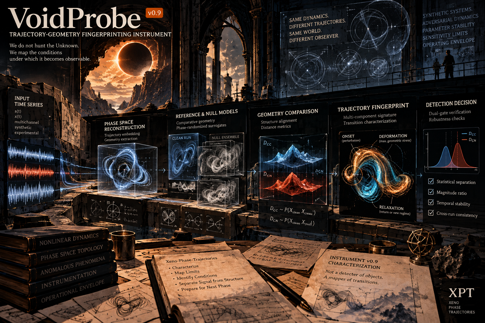

# "VoidProbe" - Instrument Characterization v0.9

**Status:** R&D Roadmap · Public Overview
**Date:** 2026-10-13

---

## What This Is

Trajectory-geometry fingerprinting pipeline. It compares trajectory components against phase-randomized nulls using a dual-gate rule plus temporal-shift stability checks.

**v0.9 characterizes this pipeline.** Before any external use, we need to know:

- What it detects
- What it cannot detect
- Under which conditions
- Where its failure modes lie

> We do not hunt the Foreign.
> We first make sure the knife is sharp enough to cut only what it claims to cut.

## Why Characterization

A detector that succeeds on one benchmark is not universal. A detector that fails on a difficult case is not broken — it may simply be operating outside its design envelope.

The goal is not to prove it works everywhere. It is to understand **where it works, where it doesn't, and why**.

Invisibility is a valid result. If a dynamical class is structurally invisible to the pipeline under tested conditions, that is information — not failure.

---

## The Five Questions

v0.9 will answers five separate questions:

1. **Baseline validity:** Can the declared v0.8 benchmark be reproduced from identifiable code and artifacts?
2. **Blind onset validity:** Can the pipeline locate a transition without being told where to look?
3. **Selectivity:** Which non-target dynamics remain invisible, which produce partial signatures, which create false positives?
4. **Sensitivity:** What minimum controlled perturbation is detectable, and how does detection depend on perturbation type, scale, duration, and base system?
5. **Robustness:** How much do results depend on embedding dimension, delay, seed, null construction, and other choices?

Each question is addressed by a separate gate or track. A favourable result in one does not compensate for failure in another.

---

## The Frozen Baseline (v0.8)

All v0.9 work builds on the frozen v0.8 pipeline:

| Parameter | Value |
|-----------|-------|
| Embedding dimension | `m = 4` |
| Time delay | `tau` = first MI minimum |
| Phase space | Native R⁴ (no dimensionality reduction) |
| Alignment | Procrustes (optimal rotation) |
| Observable | Quadratic / energy-like scalar per system |
| Null construction | Phase-randomized surrogates |
| Window inheritance | Nulls inherit the clean-run transition window |
| Shift stability | ±5 and ±10 embedded samples |

**Detection rule (dual gate):**

- Primary: `q95(D_CC) < q05(D_CN)`
- Secondary: `median(D_CN) / median(D_CC) > 10`
- Shift stability: detection remains valid under declared temporal shifts

These settings are inherited provisionally. Gate 0 verifies that the v0.8 code, contract, and results are internally consistent before v0.9 treats them as a verified baseline.

---

## Gate 0: Baseline and Provenance Audit

Before any v0.9 work begins:

- Which exact commit, branch, and files constitute the claimed v0.8 benchmark?
- Can an independent run reproduce the reported results within stated tolerances?
- Are there discrepancies among README, LOG.md, contract, scripts, and result files?

**Outcomes:** `REPRODUCED` | `PARTIALLY_REPRODUCED` | `NOT_REPRODUCIBLE` | `BLOCKED_MISSING_ARTIFACTS`

A non-reproduction is not a verdict on the underlying hypothesis. Diagnose whether the discrepancy is implementation, environment, documentation, stochastic variation, or the claim itself.

---

## Gate 1: Blind Onset Validity

**Question:** Can the pipeline estimate the time of a transition without being given the true onset, a ground-truth-aligned window, or other information that leaks the answer?

**Historical context (v0.7 blind audit):**

- NLSE: on-target blind detection (0.23 s error)
- Duffing / Van der Pol: systematic late bias (2.2–2.8 s)
- Rössler: 0/32 honest detections

**Systems:** NLSE, Duffing, Van der Pol, Rössler

**Method:** Truth fixture in a separate evaluator-only module, hashed, inaccessible to the detector. Randomized onsets within predeclared regions. Per-system reporting.

**Exit:** Validated | partially validated | refuted | inconclusive — reported per system, not pooled.

---

## Track A: Adversarial Dynamics Suite

**Question:** Which non-target, control, and boundary-case dynamical classes remain invisible, and which satisfy the gates despite not matching the focusing-related hypothesis?

| ID | System | Purpose | Initial Expectation |
|----|--------|---------|---------------------|
| ADV-01 | Lorenz-96 (N=40) | Strong chaos, no soliton structure | `INVISIBLE` |
| ADV-02 | Mackey–Glass | History-dependent dynamics | `INVISIBLE` or `PARTIAL` |
| ADV-03 | Amplitude-modulated limit cycle | Separate amplitude from geometry | `INVISIBLE` |
| ADV-04 | Discontinuous jump map | State discontinuity alone | `INVISIBLE` |
| ADV-05 | Duffing + strong noise | Nonlinearity + high noise | `INVISIBLE` / `PARTIAL` / unstable |
| ADV-06 | Coupled Van der Pol (N=8) | Collective relaxation oscillations | `INVISIBLE` |
| ADV-07 | Focusing NLSE + damping | Dissipation effect | `PARTIAL` |
| ADV-08 | Defocusing NLSE | Opposite nonlinearity sign | `INVISIBLE` |
| ADV-09 | Rössler (3D chaotic) | Historically difficult (0/32 in v0.7) | `INVISIBLE` |

**Run plan:** 32 clean + 64 nulls per system. Same windows and pipeline as v0.8. Seed family `20260921 + offset`.

**Success criterion:**

- All purely state-based / non-focusing systems remain `INVISIBLE`
- No system without focusing nonlinearity produces `STABLE` multi-component detection

A non-target system passing ≥3/4 components is flagged `FALSE_POSITIVE_CANDIDATE` and investigated. This does not prove a bug or a discovery — it triggers diagnosis.

---

## Track B: Hidden Perturbation Sensitivity

**Question:** What is the minimum perturbation the pipeline can resolve, and how does that threshold depend on perturbation class, strength, duration, and base system?

**Base systems:**

- Unperturbed NLSE soliton (focusing)
- Unperturbed Van der Pol limit cycle (non-focusing)

**Perturbation classes:**

- **P1:** Localized phase shift (sweep ε, δt)
- **P2:** Local curvature injection (sweep amplitude, width)
- **P3:** Transient focusing potential (sweep height, width, duration)

**Sweep:** ≥8 ε values × ≥6 δt/width values. 16 clean + 32 nulls per point. No-perturbation baseline included.

**Hypothesis:** Sensitivity is driven more by focusing-related geometry than by raw amplitude or energy alone. If reversed, this triggers diagnosis — not automatic failure.

**Threshold status:** If outside tested grid → `BELOW_GRID` | `ABOVE_GRID` | `UNRESOLVED`. No extrapolation.

---

## Track C: Embedding and Parameter Stability

**Question:** How sensitive are qualitative verdicts to embedding choices and other frozen parameters?

**Sweep:**

- Embedding dimension `m ∈ {3, 4, 5, 6}`
- Time delay `τ ∈ {1, 2, 3, 5}`
- Reference systems: NLSE, Duffing, Van der Pol

**Stability criterion (initial proposal):** Qualitative verdict unchanged for `m = 3–5`, `τ = 1–3` → `ROBUST` within tested region.

A sharp boundary is documented, not smoothed away. Parameter-sensitive → narrow operating envelope, revised parameter-selection protocol, or new instrument version.

---

## Closure Outcomes

**Track-level:** `COMPLETE — SUPPORTS HYPOTHESIS` | `COMPLETE — CONTRADICTS HYPOTHESIS` | `COMPLETE — MIXED / LIMITED DOMAIN` | `INCONCLUSIVE` | `BLOCKED`

**Overall:**

- `CHARACTERIZED — OPERATING ENVELOPE IDENTIFIED`
- `CHARACTERIZED — REQUIRES REVISION`
- `INCOMPLETE — EVIDENCE GAPS REMAIN`

Passing v0.9 means the pipeline has been characterized. It does not mean it is universal. It does not mean biological transfer has been demonstrated.

---

## Expected Deliverables

1. `sim/baseline_audit/` — audit report + manifest
2. `sim/blind_onset/` — code + results
3. `sim/adversarial/` — code + results per system
4. `sim/hidden_perturbation/` — sensitivity curves
5. `sim/embedding_stability/` — heatmaps
6. `sim/CONTRACT_v0.9.md` — closure summary

🛸
