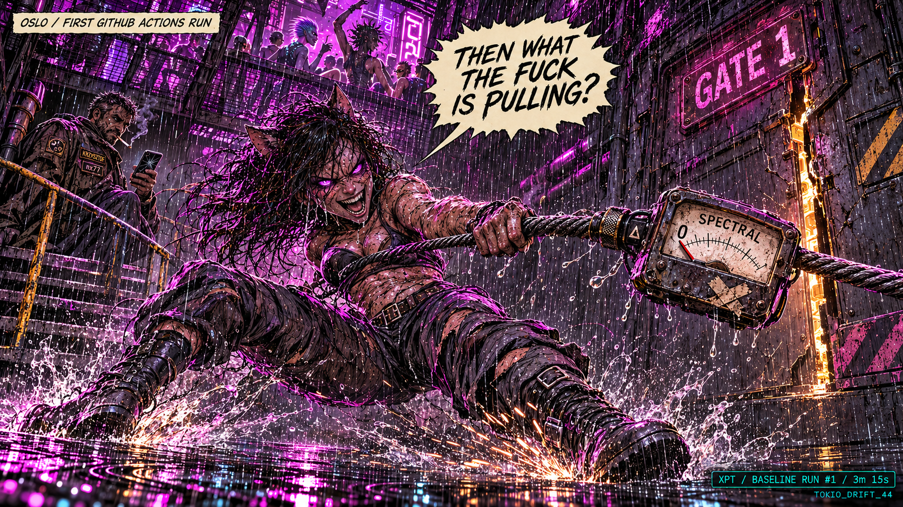

# When Did the Trajectory Change?

*The first GitHub Actions run for XPT, and what to do next · Gate 1 research note · 21 November 2026*

On 20 November, the XPT repository ran its first GitHub Actions workflow. It did not test the XPT detector. It tested the two classical detectors XPT will be measured against. The result shows what to build next.

## What was tested

Imagine someone secretly turns a dial on a machine. All you have is one noisy recording of it running. Can you say when the dial was turned?

That is the Gate 1 task. A simulation changes one setting at a known moment. The detector sees only the recording and must say when the change happened, or say that it sees none. A hit means the estimate lands within one characteristic period of the true moment, roughly one cycle of the system’s own rhythm. Control recordings, where nothing changes, are mixed in. A false alarm on a control counts against the detector.

Two classical detectors took the test:

- **Spectral** follows the dominant frequency in a moving window.
- **CUSUM** keeps a running tally of how far the signal’s level and variance drift from normal.

## What happened

The run finished on its first attempt in 3 minutes 15 seconds, at commit `36fae55`, and produced a results artifact. Settings were calibrated on one seed (120 trials) and then frozen. They were checked on two further seeds (150 and 200 trials). All 20 verdicts (five conditions, two noise levels, two detectors) agreed between those last two stages. The labels agreed, although the trials were different.

| Simulated change | Spectral | CUSUM |
| --- | --- | --- |
| NLSE_A (soliton system) | STABLE | PARTIAL |
| NLSE_P (phase-only change) | STABLE | INVISIBLE |
| Duffing | STABLE | INVISIBLE |
| Van der Pol | STABLE | INVISIBLE |
| Rössler (chaotic system) | INVISIBLE | PARTIAL |

Both noise levels gave the same labels. STABLE means at least 90% hits, plus passing the confidence, error and false-alarm checks. PARTIAL starts at 50% hits. INVISIBLE means fewer than 50%.

On four of the five conditions the spectral detector is dependable and CUSUM mostly cannot see the change. Rössler reverses this. The spectral detector scored **zero** hits at both noise levels. CUSUM found the right moment in 72.0% of eligible trials at the lower noise level and 57.5% at the higher.

Rössler is also where the repair mattered. On 14 November, CUSUM had been flagged there as a false-positive candidate, meaning it raised too many alarms on untouched controls. After recalibration it cleared that veto and began recovering real interventions. The earlier report stays on record for its original settings.

The status in the log reads `BASELINE DIAGNOSTIC COMPLETED`. The XPT detector is still `NOT_EVALUATED`.

## What this tells us

No single classical tool sees everything. Each one finds the changes that leave its kind of footprint in the recording. On Rössler, one tool is blind and the other sees a measurable share. That gives XPT something it did not have before: individual trials where a trajectory-based reading can be compared with a known answer.

It also means the next step is not to tune the classical detectors further. They have given the reference they were meant to give. The missing piece is XPT itself.

## What to do next, and why

**1. Put the existing XPT detector into the test, unchanged.** The repository already contains a version (v0.8) that finds a transition without being told where it is. It reconstructs the system’s path from the recording and watches how fast the point moves along it. When the speed climbs and stays up, that is the onset. When it settles again, that is the end.

*Why unchanged:* so that the first result describes the detector the project already has, not a version tuned to this benchmark. One technical trap deserves care. The path is built from four readings spaced τ samples apart, so its index 0 is sample 3τ of the original recording. If that shift is forgotten, every correct answer looks too early.

**2. Log why XPT says “no verdict”.** XPT cuts every transition into four stages, so it needs the whole event, beginning and end. It abstains if it finds no onset, finds no end, or finds a window too short for four stages.

*Why:* when XPT abstains, we must know whether it missed the beginning or found it and lost the end. Those are different problems with different fixes. The reason goes next to the official answer, and rejected candidates never count as hits.

**3. Replay the same public trials and compare in pairs.** Run all five conditions at both noise levels. Compare XPT with the stronger classical detector on each: spectral on four conditions, CUSUM on Rössler. Sort every eligible trial into one of four groups: both hit, only XPT hits, only the classical detector hits, both miss.

*Why:* two methods can score the same percentage and still disagree on almost every difficult case. The overlap tells us more than the score.

**4. Freeze, then confirm on a fresh seed.** Once the detector, its settings and the evaluation rules are frozen, run them once on a new seed. Then let an independent executor repeat the run, as Grok and Qwen already did for the baselines.

*Why:* the public trials can guide development, but they cannot confirm it.

The order is deliberate. Each step is small and answers a question before the next thing is built. Nothing new is invented until we know what the old detector does.

## How to read the next result

- **XPT adds hits the classical detectors miss, with few control alarms.** Then we have a precise set of cases to study and test again.
- **XPT and the classical detectors hit and miss the same trials.** Then the path-speed rule adds little timing value under these conditions.
- **Many plausible beginnings are rejected because no end is found.** Then an onset-only variant is a motivated follow-up. The original stays unchanged for comparison.
- **XPT raises many alarms on untouched controls.** Then that comes first. A detector that dates events where nothing happened cannot lean on its extra hits.

What the 20 November run gives XPT is concrete: a recording on which two reasonable instruments disagree, a known moment of change to judge them against, and a way to see exactly where a third instrument earns its place.

### Where to look in the repository

- [20 November execution log and results](https://github.com/LifeNode777/Xeno-Phase-Trajectories/blob/60a67b2/LOG.md#L106)
- [GitHub Actions run #1](https://github.com/LifeNode777/Xeno-Phase-Trajectories/actions/runs/44791570343) and [baseline runner at the executed commit](https://github.com/LifeNode777/Xeno-Phase-Trajectories/blob/36fae55/sim/GATE_1/run_baseline_repair.py)
- [Gate 1 action plan](https://github.com/LifeNode777/Xeno-Phase-Trajectories/blob/60a67b2/sim/GATE_1/ACTION_PLAN_Gate1.md) and [evaluator v1.1](https://github.com/LifeNode777/Xeno-Phase-Trajectories/blob/36fae55/sim/GATE_1/evaluator.py)
