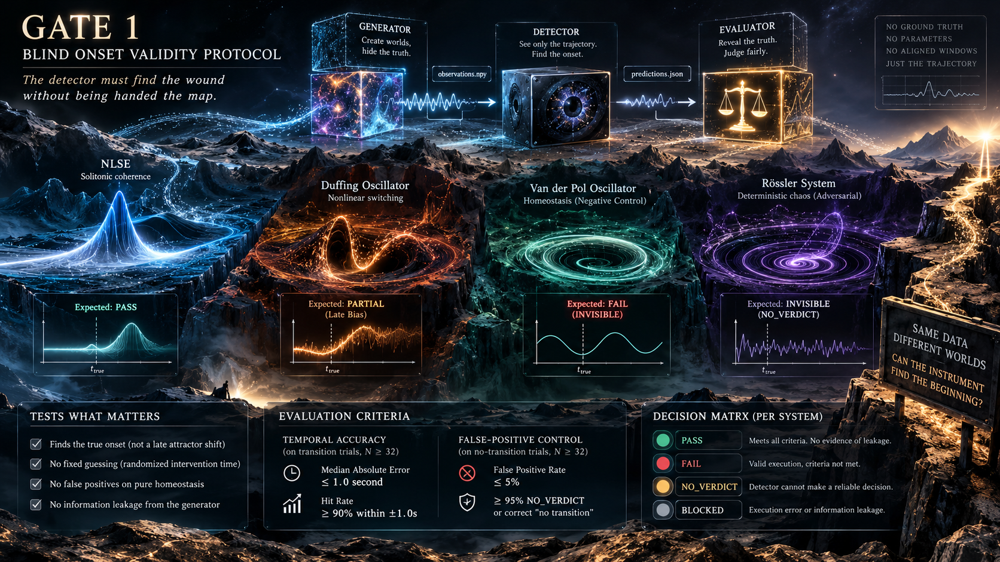

# GATE 1: Blind Onset Validity Protocol

**Status:** `DESIGN / IMPLEMENTATION PENDING`  
**Gate 0 Dependency:** `CLOSED` — `PARTIALLY_REPRODUCED` (Baseline v0.8)  
**Core Principle:** *The detector must find the wound without being handed the map.*

## 1. Purpose
Gate 1 validates a single, non-negotiable capability of the XPT instrument: **Can it independently detect and localize the onset of a dynamical transition using *only* the observable trajectory, without any access to ground-truth timing, intervention parameters, or pre-aligned windows?**

This is a strict test of *blind onset localization*. It is entirely decoupled from the geometric component profiling (v0.8). A system can pass v0.8 profiling but **FAIL** Gate 1 if it cannot find the onset blindly.

## 2. The Adversarial Research Question
Can the instrument localize the transition onset within a predefined temporal tolerance, while simultaneously proving it is **NOT** doing any of the following:
1. Detecting a late-stage attractor shift instead of the true onset.
2. Relying on a fixed, predictable intervention time (e.g., always guessing $t=4.0$s).
3. Triggering false positives on pure homeostasis (no-transition control).
4. Benefiting from information leakage (direct or indirect) from the ground-truth generator.

## 3. Scope & System Justification
The test ensemble consists of four synthetic dynamical systems. Their selection is deliberate and adversarial:

- **NLSE:** The baseline target. Represents solitonic, processual coherence. *(Expected: PASS)*
- **Duffing Oscillator:** Represents hard nonlinearity and chaotic switching. Tests if the detector can isolate the initial bifurcation from subsequent chaos. *(Expected: PARTIAL / Late Bias)*
- **Van der Pol Oscillator:** Represents classical relaxation oscillations (homeostasis). **Crucial Negative Control:** The detector *must* exhibit high latency, failure, or `NO_VERDICT` here. If it detects a precise "onset" in VdP, it is overfitting to noise, not detecting topology. *(Expected: FAIL / INVISIBLE)*
- **Rössler System:** Introduced in Gate 1 explicitly as an **adversarial stress test**. It represents deterministic chaos with a continuous attractor. Its inclusion verifies that the detector does not confuse chaotic wandering with solitonic condensation. It was `OUT_OF_SCOPE` in v0.8; its promotion to Gate 1 *increases* the rigor of the test, it does not lower the bar. *(Expected: INVISIBLE / NO_VERDICT)*

## 4. The Architecture: One-Way Data Flow
To prevent historical failures (e.g., window arbitrariness, data leakage), Gate 1 enforces a strict physical separation of concerns. The system is split into three isolated executables:

1. **`generator.py`:** Generates trials, randomizes the true intervention time ($t_{true}$) within bounded windows, and outputs blind data (`observations.npy`) and locked truth (`ground_truth.json`).
2. **`detector.py` (The Blind Instrument):** Receives **ONLY** `observations.npy` and frozen configuration. It is physically forbidden from reading ground truth. If its internal health gates fail (e.g., segment too short), it **MUST** output `NO_VERDICT`. Guessing to pad success rates is forbidden.
3. **`evaluator.py`:** Reads predictions and ground truth *only after* the detector process has terminated. It computes errors and enforces pass/fail criteria.

## 5. Evaluation Criteria (The Gates)
For a system to achieve a `PASS`, it must satisfy **both** temporal accuracy and false-positive constraints on the confirmatory test set ($N \ge 32$ valid trials).

### 5.1. Temporal Accuracy
- **Median Absolute Error:** $\le 1.0$ second (or mathematically mapped solver equivalent).
- **Hit Rate:** $\ge 90\%$ of valid trials must fall within the $\pm 1.0$s tolerance.
- *Note:* Trials resulting in `NO_VERDICT` are counted as **missed detections** in the denominator, preventing the detector from "cherry-picking" easy trials.

### 5.2. False-Positive Control (The "No-Transition" Veto)
- **Setup:** A separate batch of $N_{control} \ge 32$ trials where the system parameter is **never** changed (pure homeostasis + baseline noise).
- **Criterion:** The detector must output `NO_VERDICT` or correctly identify "no transition" in $\ge 95\%$ of these control trials.
- **Veto Rule:** If the false-positive rate exceeds 5%, Gate 1 is an **automatic FAIL** for that system, regardless of its temporal accuracy on transition trials.

## 6. Experimental Procedure
1. **Freeze:** Lock model equations, randomization bounds, and detector code.
2. **Diagnostic Run:** Execute with a diagnostic seed to verify pipeline isolation. *These results are discarded.*
3. **Confirmatory Run:** Execute with a cryptographically distinct confirmatory seed. Generate data, run blind detector, evaluate.
4. **Adjudication:** The evaluator outputs the final verdict based strictly on Section 5. **No manual override is permitted.**

## 7. Gate Decision Matrix
The final verdict is assigned **per system**, not pooled:
- **`PASS`:** Meets all temporal and false-positive criteria. No evidence of data leakage.
- **`FAIL`:** Valid execution, but criteria are not met. *(Note: A FAIL for VdP/Rössler is a successful validation of the detector's selectivity).*
- **`BLOCKED`:** Execution failed due to code errors, provenance mismatch, or detected information leakage.

## 8. Pre-Freeze Checklist (Open Specifications)
Before the confirmatory seed is generated, the following must be explicitly defined in the codebase:
- [ ] **Operational Ground Truth:** Exact mathematical definition of $t_{true}$ for each system (e.g., adjusted for RK4 solver delay).
- [ ] **Randomization Bounds:** Exact min/max bounds for $t_{true}$, ensuring transitions occur after initial transients settle.
- [ ] **Detector Health Gates:** Explicit numerical thresholds that trigger a `NO_VERDICT` (preventing forced embeddings on invalid windows).
- [ ] **Time-Base Mapping:** Documentation of how solver steps map to physical seconds, ensuring the "1.0 second" tolerance is meaningful across all four systems.
